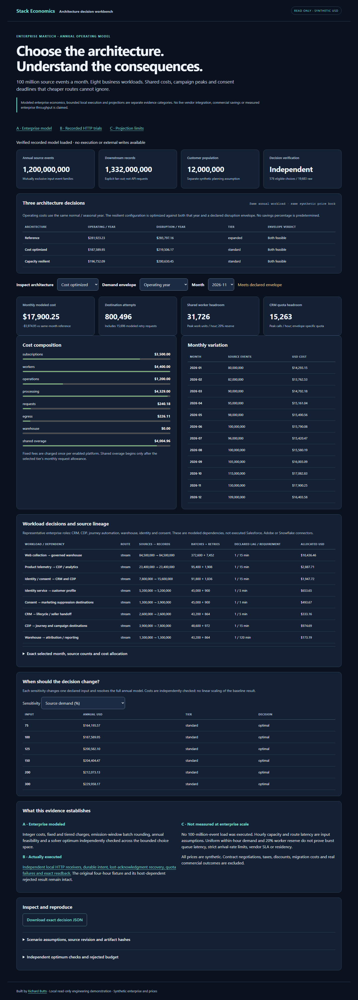
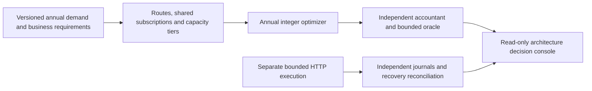

# MarTech Stack Economics

[](https://github.com/rlbsem/martech-stack-economics/actions/workflows/verify.yml)

**Which integration architecture meets a multinational marketing estate’s requirements at the lowest defensible operating cost?**

This executable architecture workbench models **100 million source events per average month**, eight integration workloads and a full seasonal operating year. It selects routes and shared capacity, accounts for subscriptions and usage tiers, and independently checks financial arithmetic, capabilities, processing regions, freshness declarations and peak API demand.

The enterprise scenario is synthetic. **All prices are synthetic USD planning assumptions**, not Adobe, Salesforce, Snowflake or cloud-provider prices. Representative CRM, CDP, journey, warehouse, identity and consent dependencies define the workloads; no native vendor execution is claimed.

## The annual architecture decision

The actual MILP solve and independent bounded enumeration produce these results from the [versioned source scenario](fixtures/enterprise/multibrand-2026.json):

| Architecture | Operating year | Disruption envelope / year | Operating monthly range |
|---|---:|---:|---:|
| Mixed-route reference, eight workers | USD $281,923.23 | USD $285,797.16 | USD $23,238.70–$23,875.20 |
| Cost optimized, four workers | **USD $187,589.95** | USD $219,506.17 | USD $13,762.53–$17,900.25 |
| Capacity resilient, four workers | USD $196,752.09 | **USD $200,630.45** | USD $16,140.91–$16,777.92 |

Each column compares the same workload and price book. The disruption column is an **alternative modeled year**, with 25% more source demand, 80% higher peak concentration, 10% retries and 70% of normal CRM quota; it is not added to the operating-year cost. All three configurations meet both declared envelopes. The optimized plan minimizes operating-year cost; the resilient plan minimizes worst annual cost across both envelopes.

The calculated operating-year difference from the reference is **USD $94,333.28**. Choosing the resilient configuration adds **USD $9,162.14** in the operating year and reduces modeled disruption-year cost by **USD $18,875.72** relative to keeping the operating optimum. These are scenario comparisons, not realized savings or commercial results.

[Inspect exact decisions, monthly lines and independent optimum checks](docs/evidence/enterprise/acceptance/decision.json) · [Assumptions and mathematical contract](docs/enterprise-economics.md) · [Execution evidence and limitations](docs/evidence/enterprise/README.md)



[Actual mobile console](docs/evidence/enterprise/browser/optimized-operating-mobile.png) · [Screenshot provenance](docs/evidence/enterprise/browser/browser-verification.json)

## Why the decision is useful

- **Source events are not API calls.** The year contains 1.2 billion source events and 1.332 billion downstream records after declared fan-out. Twelve million customers is a separate population assumption. Emission windows, partial batches and retry overhead determine requests.
- **Shared costs change the answer.** The operating optimum uses the event fabric for all eight routes: an additional platform subscription costs more than its lower variable rate saves. Under disruption, microbatching seven workloads limits request overage; one-minute consent suppression retains streaming. The solver selects these outcomes rather than prescribing a winner.
- **Capacity is a constraint, not a discount.** Every selected route must retain required fields, consent/deletion support, permitted regions and declared latency. Shared peak worker demand and CRM request quotas are checked per month. Sensitivities show when constrained throughput or quotas require larger tiers and when tighter freshness prevents batch routes.
- **A modeled plan still needs execution assurance.** Separate bounded HTTP trials retain late work, rejected permissions, uncertain acknowledgments and host-dependent rejection. An inexpensive incomplete run cannot be accepted merely because it costs less.



## Run and inspect

Python **3.12**; no cloud account, API key, model endpoint or Docker engine is required for the reproducible core.

```bash
python -m venv .venv
# Activate .venv using your shell.
python -m pip install -r requirements.lock
python -m pip install --no-deps --no-build-isolation -e .

# Open the current enterprise decision view; recorded HTTP trials remain at /execution.
python -m stack_economics.enterprise.console
# http://127.0.0.1:8578/

# Recompute the annual alternatives, independent optimum checks and sensitivities.
python scripts/enterprise_verify.py --check docs/evidence/enterprise/acceptance
python scripts/enterprise_verify.py --output .local/enterprise-01

# Full regression, original oracle, real HTTP trials and enterprise verification.
# Use a NEW directory; evidence is not overwritten. This finite suite takes several minutes.
python scripts/verify_assurance.py --output .local/acceptance-01
python scripts/package_integrity.py
python scripts/audit_public.py
```

[Browser verification commands](docs/enterprise-economics.md#browser-verification) · [HTTP and recovery contracts](docs/execution-assurance.md) · [Original CLI operations](docs/operations.md)

## Evidence boundaries

| Category | What is established | What is not established |
|---|---|---|
| Enterprise modeled | Annual costs, monthly billing, route eligibility, hourly capacity, budget and independently checked finite optimum | Measured enterprise throughput, vendor SLA, real negotiated prices or commercial savings |
| Bounded executed | Actual independent local HTTP processes, durable intent, receipts, retries, exact readback and freshness decisions | Native Salesforce/Adobe/Snowflake integration or a 100-million-event load test |
| Projection | Explicit input sensitivity and conditional architecture decisions | A measured scale factor converting local timings into production capacity |

The hourly model assumes balanced emission within each hour and a 20% worker reserve. Declared route lag is an input; intra-hour queue tails, arbitrary synchronized bursts, strict rolling arrival limits and residency certification are outside the mathematical proof. [Full assumptions, units and exclusions](docs/enterprise-economics.md).

## Preserved small-scale validation

The original five-workflow, four-hour fixture remains unchanged: **USD $7.82** modeled optimum versus **USD $13.40** all-premium reference, independently enumerated across **3,125 configurations**. Its actual accepted local architecture revision cost **USD $12.36** for 56,700 synthetic operations. The recorded slower Windows outcome remains rejected.

These figures are a bounded technical validation, separate from the enterprise annual scenario. Original optimizer behavior, regression tests, pricing, historical failures, source evidence and license are protected byte-for-byte by the package checks.

[Original mathematical proof](docs/evidence/report.md) · [Recorded execution, rejected trials and source revisions](docs/evidence/execution/README.md) · [Original architecture](docs/architecture.md) · [Original validation](docs/validation.md)
