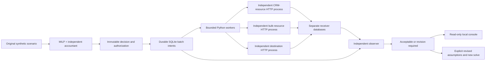

# Architecture cost and capacity assurance

An architect can choose a mathematically feasible plan and still encounter exhausted APIs, expired source data or ambiguous effects. This extension tests that boundary. The original solver, integer accountant, 3,125-choice oracle, prices and historical evidence retain their original bytes. The implementation lives in a separate `assurance` subpackage because the original saved-plan implementation hash intentionally covers the original package modules.

## Execution topology



Five workflows retain their original business owners and freshness requirements: lead handoff, campaign suppression, attribution refresh, web personalization and enrichment. Selected routes determine real batch sizes and prerequisite resource calls. CRM/bulk resource receipts must be confirmed before the destination call. These are explicit local HTTP contracts, **not Salesforce, Adobe or integration-vendor APIs**.

Every receiver runs in its own operating-system process with an independent SQLite database. The executor persists source records, intents, attempts and receipts separately. SQLite WAL commits use `synchronous=FULL`; a keeper connection avoids reopening the WAL on every request. Local filesystem/OS guarantees remain a dependency; this is not disaster-recovery certification.

## Receiver contract and measurement

| Operation | Behavior and observation |
|---|---|
| `POST /batches` | Exact key/content identity; bounded batch; synthetic workflow records; independent arrival/status/size/hash journal |
| Same key and content | Returns the original receipt; one committed batch effect, another counted request |
| Same key, changed content | HTTP 409, no replacement of the original effect |
| `GET /receipts/{key}` | Exact independent receipt readback; separately counted request and synthetic probe price |
| Capacity exhausted | HTTP 429; arrival remains visible; no admission/effect |
| Permission revoked | HTTP 403; no new effect; historical receipt queries remain a distinct operation |
| Lost acknowledgement | Commit first, delay response beyond client timeout; recover by exact receipt readback |

Only well-formed contract-operation traffic is measured by these receiver journals; unknown routes and malformed-request validation are outside the workload accounting contract. Record IDs are namespaced by workflow/slot/index. Upserts carry synthetic custom fields; delete operations seed and remove a synthetic row within the receiver transaction. They test deletion statements, not a real vendor's deletion guarantees. Independent final readback checks every retained record and every expected absence.

Receivers enforce **admitted** requests per anchored fixed window and across the horizon. All well-formed arrivals, including rejected/retried requests and receipt probes, remain separately visible. Admission compliance is not a strict rolling-window or receiver-arrival rate guarantee. The observer reports maximum arrival buckets and buckets exceeding admission capacity. There is no claim of globally smooth pacing or fair scheduling.

## Time, cost and failure boundaries

The default clock maps a 60-minute modeled slot to 36 real seconds. Four slots release actual synthetic source updates over that accelerated schedule. A ten-minute freshness requirement therefore allows six real seconds; a sixty-minute requirement allows 36. Actual source creation, readiness, arrival and commit timestamps are captured, not backdated to make tests pass. Source delay happens **after** source capture. Wall-clock time must remain stable for this finite test. These measurements do not establish production throughput or a vendor SLO.

Original route pricing is preserved: enabled platform fees once per trial, plus the selected destination batch price. The runtime pricing extension explicitly charges every destination POST attempt, including retries/rejections, at that route price, and every receipt GET at one synthetic cent. Prerequisite resource calls consume capacity but have no additional fee under this fixture. Failed or incomplete processing may cost less; it is not an accepted saving. Budget overrun causes rejection after independent reconciliation. This synthetic demonstration is not a real-money spending guard.

The independent observer imports neither the executor nor the compiler/accountant. It recomputes ceiling batch counts, fixed fees, request charges, source coverage, admitted capacity, receipt identities, final records, deadline attainment, source-to-request delay and peak queued batches. Executor attempts must agree with independent receiver counts. Source clocks, configs and receipt hashes are checked; altered evidence causes rejection. SHA-256 files provide integrity and revision binding, not protection against a malicious administrator replacing an entire unsigned package.

Transient retries are bounded by both attempts and the current source deadline. Before replaying an uncertain POST, the worker performs exact-content receipt reconciliation. A 404 permits only the **same key and content** to retry; receiver uniqueness protects the race with an original in-flight request. A conflict, unverifiable receipt, exhausted attempts or denied probe leaves the intent unresolved/blocked. An already committed effect can remain late or unresolved even after a local timeout. The observer never converts that into a successful fresh delivery.

## Decision governance

Decisions bind scenario, plan, profile, run context and optional parent by content hash. Append-only SQLite triggers protect decision documents and transitions from ordinary update/delete operations. Progression is proposed → validated → authorized → observed → acceptable/revision-required, or proposed → blocked. Authorization is a named **synthetic local fixture actor**, not enterprise SSO, legal approval or a security boundary against the machine owner.

An execution-profile change invalidates authorization. Revisions keep budget, workload semantics, required fields, deletion capability, regions, demand and freshness unchanged. The observed reduced CRM capacity is supplied explicitly to the original solver. A 60-request capacity admits a different feasible architecture; 30 requests yields no feasible recommendation. Each trial uses fresh synthetic receiver state; this is evaluation of a revised architecture, not an in-place production migration.

## Reproduction and inspection

Follow the root installation instructions. `python scripts/verify_assurance.py --output .local/acceptance-01` runs regression, mathematical proof, real HTTP trials and independent replay of the evidence. Always choose a fresh directory. Expect approximately 15–20 minutes for the default full clock, depending on the host. `--quick` executes full normal and surge scenarios only; it is not full fault acceptance.

For browser verification, install `requirements-browser.lock`, run `python -m playwright install chromium`, then `python scripts/fetch_browser_tools.py`. The optional axe-core 4.11.0 tool is fetched from its official npm package, checked against a pinned SHA-256 and retained only locally with its license. Run:

```bash
python scripts/browser_acceptance.py --evidence .local/acceptance-01/execution --output .local/browser-01
```

Chromium checks actual desktop/mobile states, WCAG 2 A/AA + 2.1 AA rules, downloads, source hashes, keyboard access, viewport overflow, origin/host rejection and absence of write routes. Automated accessibility checks are not a comprehensive human accessibility audit.

The console binds loopback only, serves an explicit route allowlist, rejects foreign Host/Origin values, uses a strict CSP and offers no write API. Do not expose it publicly. It executes no workload from a browser request. The static screenshots are genuine views of recorded evidence, not a hosted deployment.

CI repeats acceptance on Windows/Linux, runs browser checks on Linux, and executes the installed package in a Linux container with no external network, no root privileges, bounded CPU/memory/processes, read-only image and finite writable evidence/temp mounts. The official Python base is pinned to the digest actually resolved by the first container build; image inspection is retained. Numerical thread pools are bounded to one thread. Independent receivers do not import the optimizer. Dependencies are version pinned, not a supply-chain attestation.

Acceptance requires a complete normal trial, an accepted explicit capacity revision and rejection of the defined invalid conditions. The original surge's runtime verdict is **measured**, not forced to match the optimizer's feasibility result. A correctly rejected surge is useful execution evidence. Neither failed work nor fewer delivered records can count as an acceptable cost reduction.
